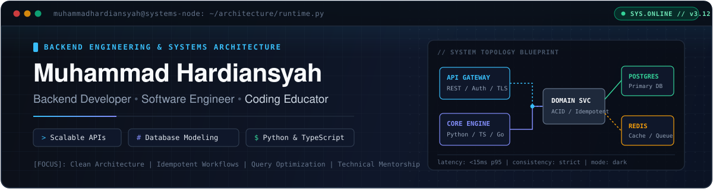

<div align="center">

<picture>
  <source media="(prefers-color-scheme: dark)" srcset="./assets/banner-dark.svg" />
  <source media="(prefers-color-scheme: light)" srcset="./assets/banner-light.svg" />
  
</picture>

<br />

[](https://github.com/muhammadhardiansyah)
[](https://ggstudy.vercel.app)
[](#technical-architecture--stack)
[](https://github.com/muhammadhardiansyah/muhammadhardiansyah/actions)

</div>

---

## `01` // The Engineer's Manifesto

I design and build backend services, relational data models, and interactive learning platforms. My engineering approach prioritizes **predictable state transitions**, **strict schema design**, and **maintainable codebases** over unnecessary abstraction. Alongside building production web systems, I mentor students in foundational programming and algorithmic problem-solving with Python.

```python
from dataclasses import dataclass, field
from typing import Tuple


@dataclass(frozen=True)
class SystemsEngineer:
    name: str = "Muhammad Hardiansyah"
    role: str = "Backend Developer & Software Engineer"
    secondary_role: str = "Coding Educator (Python & Algorithmic Foundations)"

    core_domains: Tuple[str, ...] = (
        "RESTful API Design & Service Architecture",
        "Relational Data Modeling & Query Optimization",
        "Authentication, Token Cryptography & Idempotent Workflows",
        "Interactive Educational Tooling & Automated Code Evaluation",
    )

    engineering_principles: dict[str, str] = field(
        default_factory=lambda: {
            "architecture": "Explicit boundaries, minimal coupling, high cohesion",
            "data_layer": "Strict schema constraints first, application logic second",
            "reliability": "Idempotent mutations, deterministic error contracts",
            "pedagogy": "Translate complex computer science into executable mental models",
        }
    )

    def healthcheck(self) -> dict[str, str | bool]:
        return {
            "status": "ONLINE",
            "open_to_collaboration": True,
            "primary_stack": "Python • TypeScript • Node.js • PHP • PostgreSQL",
        }
```

---

## `02` // Technical Architecture & Stack

Grouped by functional responsibility across the system lifecycle:

<table>
  <thead>
    <tr>
      <th width="33%" align="left">Languages &amp; Backend Runtimes</th>
      <th width="33%" align="left">Databases &amp; Data Layer</th>
      <th width="34%" align="left">Infrastructure, Cloud &amp; Delivery</th>
    </tr>
  </thead>
  <tbody>
    <tr>
      <td valign="top">
        <p>
          
          
          
          
          
          
          
        </p>
        <ul>
          <li>REST API design &amp; middleware pipelines</li>
          <li>Next.js App Router &amp; Server Actions</li>
          <li>Express.js / FastAPI service backends</li>
          <li>Asynchronous worker &amp; webhook handling</li>
        </ul>
      </td>
      <td valign="top">
        <p>
          
          
          
          
          
        </p>
        <ul>
          <li>Relational schema normalization &amp; indexing</li>
          <li>ACID transactions &amp; balance ledger integrity</li>
          <li>Connection pooling for serverless runtimes</li>
          <li>Query profiling &amp; N+1 elimination</li>
        </ul>
      </td>
      <td valign="top">
        <p>
          
          
          
          
          
          
        </p>
        <ul>
          <li>CI/CD automation via GitHub Actions</li>
          <li>JWT / HMAC cryptographic token verification</li>
          <li>VPS provisioning &amp; environment hardening</li>
          <li>Automated testing &amp; API contract validation</li>
        </ul>
      </td>
    </tr>
  </tbody>
</table>

---

## `03` // Featured Engineering Works

Selected repositories demonstrating backend service architecture, full-stack systems integration, and educational tooling:

<table>
  <thead>
    <tr>
      <th width="26%" align="left">System / Repository</th>
      <th width="49%" align="left">Architecture &amp; Engineering Scope</th>
      <th width="25%" align="left">Stack &amp; Deployment</th>
    </tr>
  </thead>
  <tbody>
    <tr>
      <td valign="top">
        <strong><a href="https://github.com/muhammadhardiansyah/ggstudy">ggstudy</a></strong><br />
        <sub>Interactive Coding &amp; Mentorship Platform</sub>
      </td>
      <td valign="top">
        End-to-end learning portal featuring a 16-session Python curriculum, interactive in-browser code execution &amp; evaluation, automated post-session progress reporting, and cryptographic token-verified invoicing.
      </td>
      <td valign="top">
        <code>TypeScript</code> <code>Next.js</code> <code>Python</code><br />
        <a href="https://ggstudy.vercel.app">🔗 ggstudy.vercel.app</a>
      </td>
    </tr>
    <tr>
      <td valign="top">
        <strong><a href="https://github.com/muhammadhardiansyah/wedding-catalog-api">wedding-catalog-api</a></strong><br />
        <sub>RESTful Catalog &amp; Order Service</sub>
      </td>
      <td valign="top">
        Decoupled backend API managing service packages, booking workflows, media assets, and administrative authentication for the <a href="https://github.com/muhammadhardiansyah/wedding-catalog-web">wedding-catalog-web</a> client.
      </td>
      <td valign="top">
        <code>Node.js</code> <code>REST API</code> <code>SQL</code><br />
        <a href="https://wedding-catalog-api.vercel.app">🔗 API Endpoint</a> • <a href="https://wedding-catalog-web.vercel.app">Web</a>
      </td>
    </tr>
    <tr>
      <td valign="top">
        <strong><a href="https://github.com/muhammadhardiansyah/nutech-backend">nutech-backend</a></strong><br />
        <sub>Transactional REST API Service</sub>
      </td>
      <td valign="top">
        Backend transaction engine implementing JWT authentication, balance top-up mutations, payment processing endpoints, and parameterized SQL queries for ledger consistency.
      </td>
      <td valign="top">
        <code>JavaScript</code> <code>Node.js</code> <code>REST</code><br />
        <a href="https://github.com/muhammadhardiansyah/nutech-backend">🔗 Source Repository</a>
      </td>
    </tr>
    <tr>
      <td valign="top">
        <strong><a href="https://github.com/muhammadhardiansyah/ziyad-books">ziyad-books</a></strong><br />
        <sub>Digital Publishing &amp; Book Catalog</sub>
      </td>
      <td valign="top">
        Structured digital catalog system built with TypeScript, featuring fast filtering, responsive book previews, and clean data presentation.
      </td>
      <td valign="top">
        <code>TypeScript</code> <code>Vercel</code><br />
        <a href="https://ziyad-books.vercel.app">🔗 ziyad-books.vercel.app</a>
      </td>
    </tr>
  </tbody>
</table>

---

## `04` // Activity Telemetry & Contribution Graph

<div align="center">

<picture>
  <source
    media="(prefers-color-scheme: dark)"
    srcset="https://github-readme-stats.vercel.app/api?username=muhammadhardiansyah&show_icons=true&theme=tokyonight&hide_border=true&bg_color=0B0F17&title_color=38BDF8&icon_color=818CF8&text_color=CBD5E1"
  />
  <source
    media="(prefers-color-scheme: light)"
    srcset="https://github-readme-stats.vercel.app/api?username=muhammadhardiansyah&show_icons=true&theme=default&hide_border=true&bg_color=F8FAFC&title_color=0284C7&icon_color=4F46E5&text_color=334155"
  />
  
</picture>
<picture>
  <source
    media="(prefers-color-scheme: dark)"
    srcset="https://github-readme-stats.vercel.app/api/top-langs/?username=muhammadhardiansyah&layout=compact&langs_count=6&theme=tokyonight&hide_border=true&bg_color=0B0F17&title_color=38BDF8&text_color=CBD5E1"
  />
  <source
    media="(prefers-color-scheme: light)"
    srcset="https://github-readme-stats.vercel.app/api/top-langs/?username=muhammadhardiansyah&layout=compact&langs_count=6&theme=default&hide_border=true&bg_color=F8FAFC&title_color=0284C7&text_color=334155"
  />
  
</picture>

<br /><br />

<picture>
  <source
    media="(prefers-color-scheme: dark)"
    srcset="https://raw.githubusercontent.com/muhammadhardiansyah/muhammadhardiansyah/output/github-contribution-grid-snake-dark.svg"
  />
  <source
    media="(prefers-color-scheme: light)"
    srcset="https://raw.githubusercontent.com/muhammadhardiansyah/muhammadhardiansyah/output/github-contribution-grid-snake.svg"
  />
  
</picture>

</div>
